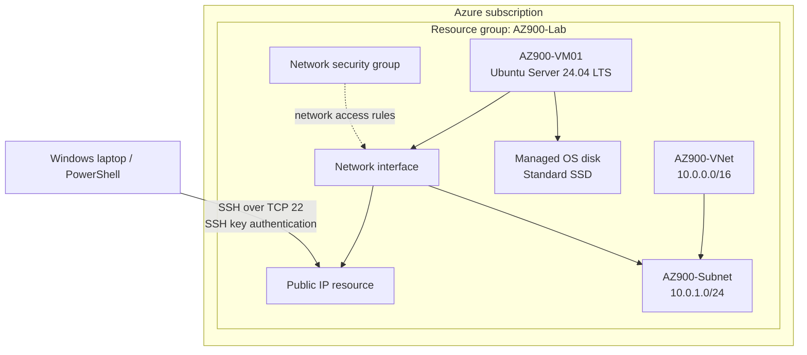

# Azure VM & Networking Lab

A hands-on Microsoft Azure infrastructure lab: deploy an Ubuntu virtual machine, connect over SSH, and validate its network configuration.

## Objective

Build a small Azure environment in the Portal and practise the core steps involved in administering a cloud-hosted Linux VM: resource inspection, IP addressing, routing, DNS, and basic connectivity testing.

## Architecture

For screenshots and additional testing notes, see the [screenshot gallery](docs/screenshots/README.md), [architecture notes](docs/architecture.md), and [lab validation log](docs/lab-validation.md).

## Environment

| Component | Configuration |
|---|---|
| Resource group | `AZ900-Lab` |
| Region / availability zone | South Africa North / Zone 1 |
| Virtual network | `AZ900-VNet` — `10.0.0.0/16` |
| Subnet | `AZ900-Subnet` — `10.0.1.0/24` |
| Virtual machine | `AZ900-VM01` |
| Operating system | Ubuntu Server 24.04 LTS |
| VM size | Standard B2ats_v2 — 2 vCPUs, 1 GiB RAM (as displayed in the Portal) |
| OS disk | Managed Standard SSD |
| Private IP observed in the VM | `10.0.1.4` |
| Administration | SSH from Windows PowerShell using public-key authentication |

The public IP value, subscription identifiers, and SSH private key are not included in this repository.

## Work completed

- Created the resource group, virtual network, and subnet in the Azure Portal.
- Deployed an Ubuntu Linux VM in South Africa North, Zone 1.
- Inspected the VM size, OS disk, network interface, IP configuration, and associated network resources.
- Connected remotely over SSH using a private key stored locally.
- Used Linux commands to inspect the hostname, interface addressing, and routing table.
- Tested outbound connectivity to a public IP address and tested DNS resolution using a hostname.
- Inspected Ubuntu's resolver configuration and observed both IPv4 and IPv6 DNS answers.
- Deallocated the VM when the lab was not in use.

## Validation results

Commands were run from inside the Ubuntu VM.

| Command | Purpose | Observed result |
|---|---|---|
| `hostname` | Identify the machine | Returned `AZ900-VM01` |
| `ip address` | Inspect interfaces and IP addresses | `eth0` showed `10.0.1.4/24` |
| `ip route` | Inspect connected and default routes | Included the connected `10.0.1.0/24` route and a default route via `10.0.1.1` |
| `ping -c 4 8.8.8.8` | Test outbound IP connectivity | 4 replies received; 0% packet loss during the test |
| `ping -c 4 google.com` | Test DNS resolution and connectivity | Name resolved and 4 replies were received during the test |
| `nslookup google.com` | Query DNS | Returned IPv4 and IPv6 records |
| `resolvectl status` | Inspect resolver configuration | Listed `168.63.129.16` as the DNS server for `eth0`; `nslookup` showed the local stub at `127.0.0.53` |

A ping to `10.0.1.1` did not receive ICMP replies, while outbound connectivity to `8.8.8.8` succeeded. This is a useful troubleshooting reminder: a next-hop address not replying to ping does not, on its own, prove that routing is broken.

## Skills practised

- Azure resource groups, virtual machines, regions, and availability zones
- Azure Virtual Network and subnet addressing
- Network interfaces and public/private IP addressing
- SSH remote administration and key-based authentication
- Basic Linux network diagnostics
- Routing-table interpretation and DNS troubleshooting

## Security considerations

- SSH on TCP port 22 was enabled to access this learning VM.
- For production systems, restrict inbound SSH to trusted source addresses and consider private access or a controlled service such as Azure Bastion.
- Do not publish private keys, credentials, public IP values, or subscription/tenant identifiers.
- The repository's `.gitignore` helps exclude common local key and secret-file patterns; it does not replace careful handling of sensitive files.

## Scope

This is a single-VM learning lab, not a production or high-availability design. App Service, Azure Container Instances, VM Scale Sets, Availability Sets, Azure Virtual Desktop, and VNet peering were reviewed as Azure concepts but were not deployed in this project.

## Related certification

Microsoft Certified: Azure Fundamentals (AZ-900).
