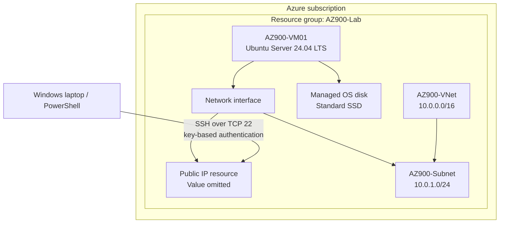

# Lab architecture

This diagram shows the major resources and logical associations used in the lab. The VM's public IP value and all credentials are intentionally omitted.

## Addressing

- VNet address space: `10.0.0.0/16`
- Subnet range: `10.0.1.0/24`
- Private IP observed on the VM: `10.0.1.4`

The actual public IP, subscription IDs, and private SSH key are deliberately not documented.
