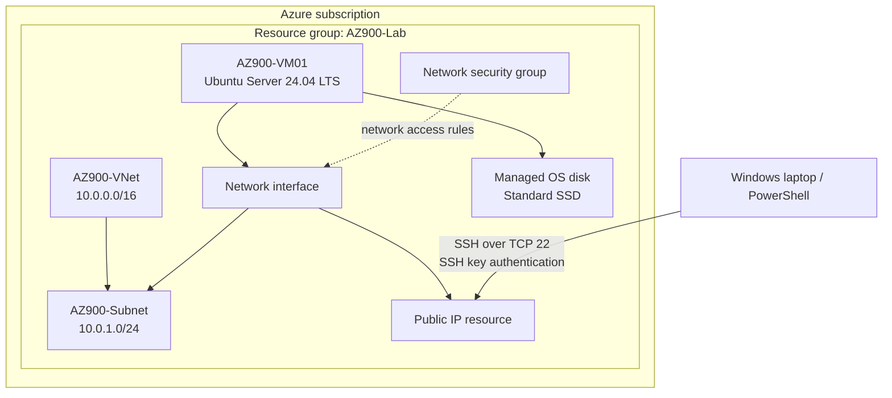

# Lab architecture

The diagram below shows the main Azure resources and their relationships. The actual public IP value and all credentials are omitted.

## Addressing

- VNet address space: `10.0.0.0/16`
- Subnet address range: `10.0.1.0/24`
- Private IP observed inside the VM: `10.0.1.4`

The subnet is a smaller address range within the VNet's address space. The VM's network interface connects it to the subnet.

This diagram represents the lab configuration at a conceptual level; it does not expose the public IP value or identify any physical Azure infrastructure.
