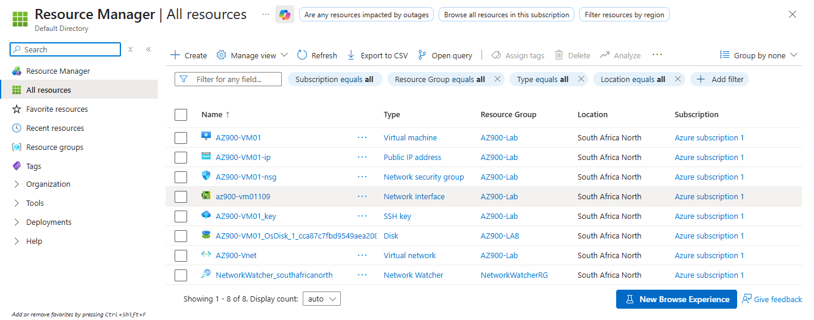

# Azure Portal screenshots

This folder contains selected, sanitized screenshots supporting the [Azure VM & Networking Lab](../../).

## 01 — Azure resource inventory

A view of the Azure Portal's **All resources** page showing the VM and supporting networking/storage resources used for the lab. The automatically created Network Watcher resource appears in its own resource group.

## 02 — VNet address space

Shows the address space configured for `AZ900-VNet`.

Once the image is uploaded to this folder as `02-address-space.png`, add it below:

`02-address-space.png`

## Screenshot hygiene

Screenshots should not expose public IP addresses, subscription or tenant IDs, account email addresses, credentials, or private keys. Crop or redact unnecessary information before publishing.
