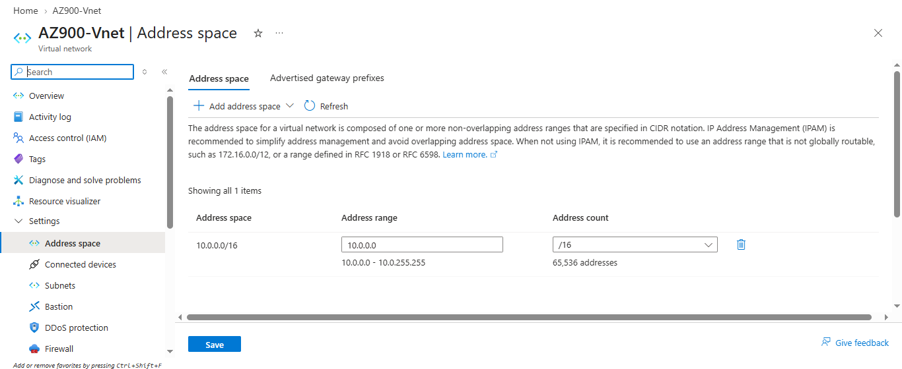

# Azure Portal Screenshot Gallery

These screenshots document the Azure configuration used in the [VM and networking lab](../../).

## 01 — Azure resource inventory

**What is shown**

The Azure Portal's **All resources** view lists the main lab resources:

- `AZ900-VM01` — the Ubuntu virtual machine.
- `AZ900-VNet` — the virtual network.
- The VM's network security group and network interface.
- The managed OS disk, public IP resource, and SSH key resource.
- A Network Watcher resource in a separate resource group.

**Project work represented**

The VM was deployed and its supporting compute, storage, and network resources were inspected in the Azure Portal. This view shows how a VM uses several associated Azure resources.

**Relevant topics:** resource groups, virtual machines, network interfaces, network security groups, and managed disks.

## 02 — Virtual network address space

**What is shown**

The address-space configuration for `AZ900-VNet`. The configured range is `10.0.0.0/16`, from `10.0.0.0` through `10.0.255.255`.

**Project work represented**

The VNet address space was inspected and related to the subnet used by the VM. The subnet range is `10.0.1.0/24`, and the private IP observed inside the VM was `10.0.1.4`.

**Relevant topics:** virtual networks, CIDR notation, subnetting, and private IP addressing.

## Security and privacy

The screenshots avoid showing the VM's public IP value and any credentials. Private keys, passwords, tokens, and other secrets must never be uploaded. Review future screenshots for account details and subscription or tenant identifiers before publishing them.
